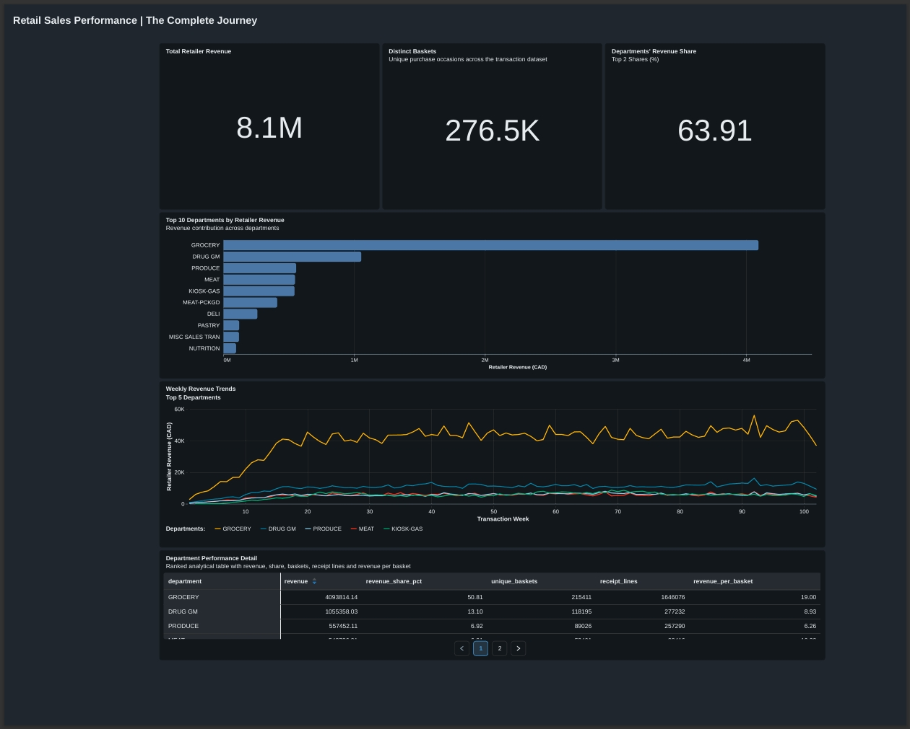
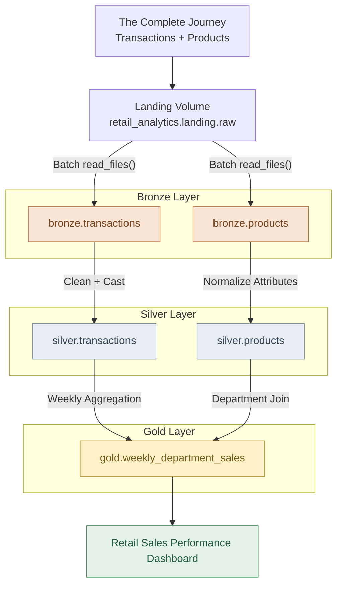

# Grocery Retail & Loyalty Lakehouse

> **Status:** Version 1 — Initial batch pipeline implemented and validated.

An end-to-end retail analytics lakehouse built with **Databricks, Delta Lake, Unity Catalog and SQL**, transforming 2.6 million grocery transaction records into validated analytical datasets.

The project uses dunnhumby's *The Complete Journey* dataset to demonstrate how retail organizations can ingest, validate, transform and analyze sales data using a Bronze–Silver–Gold architecture. The initial release processes **2,595,732 receipt lines**, reconciles **8,057,463.08 in retailer revenue** without a difference between Silver and Gold, and powers an interactive Databricks sales-performance dashboard. The ingestion and transformations currently use **manually executed batch SQL**, not a scheduled or streaming pipeline.



> Dashboard screenshot captured during development. The Databricks published dashboard requires appropriate account access; this repository provides a public view of the outputs. **[Databricks Dashboard Link](https://dbc-2a24b770-41e6.cloud.databricks.com/dashboardsv3/01f1dcd724271524bcd953504697f917/published?o=7474644044205981)**

## Business problem

Retail category managers and operations analysts need reliable answers to three questions:

1. Which departments contribute most to retailer revenue?
2. How does departmental revenue vary across the dataset's observation weeks?
3. How do revenue concentration and basket activity differ across departments?

The dashboard answers these questions with **revenue and basket KPIs**, a **top-department ranking**, **weekly revenue trends**, and a **department detail table**. Retailer revenue is not necessarily the customer's out-of-pocket spending after manufacturer coupon reimbursement.


## Verified results

| Metric | Initial batch result |
|---|---:|
| Receipt lines processed | 2,595,732 |
| Distinct purchase baskets | 276,484 |
| Total retailer revenue | 8,057,463.08 (source currency) |
| Silver ↔ Gold receipt-line difference | 0 |
| Silver ↔ Gold revenue difference | 0.00 |
| Transaction lines with unmatched product IDs | 0 |
| Grocery share of total retailer revenue | ~50.8% |
| Grocery + Drug GM combined revenue share | ~63.9% |

**Interpreting the metrics:** A `basket_id` identifies a purchase occasion; a receipt line is one row representing a purchased product on that occasion. Overall basket counts are computed with `COUNT(DISTINCT basket_id)` on the transaction table, **not** by summing distinct basket counts by department, which can double-count baskets containing several departments. The published dashboard rounds values for display.

The dataset uses relative transaction days and weeks; visualizations label the x-axis **Transaction Week** rather than pretending to have calendar dates. The data dictionary does not establish CAD as the currency, so results here use **source currency**.

## Implemented architecture



The catalog also contains separate `landing`, `bronze`, `silver`, and `gold` schemas. The initial SQL uses `CREATE OR REPLACE TABLE` batch refreshes. **Auto Loader, CDC, SCD Type 2, scheduling, and automated quality gates are planned, not yet implemented.**

## Data sources

- **Publisher:** [dunnhumby — The Complete Journey](https://www.dunnhumby.com/source-files/), original CSV release.
- **Loaded sources:** `transaction_data.csv` and `product.csv`.
- **Later phases:** Household demographics, campaigns, coupons, and simulated change events. The source archive is historical data, not a live CDC stream.

The source is described as a *representation* of approximately two years of household shopping activity. Do not interpret it as a live production feed or assume all measures are comparable across departments. Raw source files are **not** redistributed here; obtain them from the publisher, subject to applicable terms.

## Dashboard and analytical model

**Gold table:** `retail_analytics.gold.weekly_department_sales`  
**Grain:** one row per `(week_no, department)`.

The dashboard contains:

- **KPIs:** total retailer revenue, unique baskets, top-two-department revenue share.
- **Top 10 departments:** ranked by retailer revenue (horizontal bar chart).
- **Weekly performance:** revenue across the five leading departments (line chart).
- **Department detail:** revenue, revenue share, department-specific baskets, receipt lines, and revenue per basket.

**Known interpretation caveats:** `KIOSK-GAS` and `MISC SALES TRAN` have unusually large `quantity` totals compared with their revenue. Unit-of-measure compatibility has not been established, so no all-department units-sold KPI is presented. An `UNMAPPED` department appears with zero aggregate revenue/units and still needs investigation; zero unmatched product IDs does not prove every product has a populated department.

## Quality and reproducibility

The following scripts are version-controlled:

| File | Purpose |
|---|---|
| `sql/10_bronze.sql` | Load transactions and products to Bronze |
| `sql/11_bronze_validation.sql` | Bronze structural checks |
| `sql/20_silver.sql` | Clean and type transactions and products |
| `sql/21_silver_validation.sql` | Row/revenue reconciliation and product references |
| `sql/30_gold.sql` | Weekly department sales model |
| `sql/31_gold_validation.sql` | Silver-to-Gold reconciliation |

See [the data-quality report](docs/data_quality.md) for executed checks and limitations, and the [project proposal](docs/project_proposal.md) for the target production-oriented design.

### Reproduce the initial batch

1. Obtain the original dunnhumby source files and upload `transaction_data.csv` and `product.csv` into `/Volumes/retail_analytics/landing/raw/`.
2. In Databricks SQL Editor, use a SQL warehouse and run the catalog/schema/volume initialization statements below if not already provisioned.
3. Run **the transformation scripts in order**: `10_bronze.sql`, `20_silver.sql`, `30_gold.sql`.
4. Run the validation scripts `11_bronze_validation.sql`, `21_silver_validation.sql`, and `31_gold_validation.sql` at their corresponding stages; review results before continuing. Validation queries currently **report** metrics but do not automatically fail a job.
5. Build the dashboard from the Gold table and related SQL datasets; the dashboard definition can be exported from Databricks as `.lvdash.json` for future version control.

```sql
CREATE CATALOG IF NOT EXISTS retail_analytics;
CREATE SCHEMA IF NOT EXISTS retail_analytics.landing;
CREATE SCHEMA IF NOT EXISTS retail_analytics.bronze;
CREATE SCHEMA IF NOT EXISTS retail_analytics.silver;
CREATE SCHEMA IF NOT EXISTS retail_analytics.gold;
CREATE VOLUME IF NOT EXISTS retail_analytics.landing.raw;
```

### Local development prerequisites

- Python 3.11 or 3.12, Git, and access to a Databricks workspace / SQL warehouse.
- Modern standalone Databricks CLI, installed separately from Python packages.
- Python packages defined by `pyproject.toml` with a `requirements-lock.txt` snapshot.

**Windows with Git Bash:** install the Windows CLI from PowerShell with `winget install --id Databricks.DatabricksCLI -e`, restart your terminal, and activate `.venv` using `source .venv/Scripts/activate`.

**Linux / WSL:** follow the [official Databricks CLI installation instructions](https://docs.databricks.com/aws/en/dev-tools/cli/install); Linux virtual environments use `source .venv/bin/activate` and cannot reuse a Windows `.venv`.

```bash
python -m pip install -e ".[dev]"
databricks auth login --host https://YOUR-WORKSPACE-URL --profile retail-dev
databricks current-user me --profile retail-dev
```

The existing `databricks.yml` provides a development bundle configuration but **does not yet define orchestration jobs**. Use your own workspace host or authenticated profile. Never commit credentials, `~/.databrickscfg`, raw source datasets, or local `.venv` files.

## Current scope and next milestones

| Workstream | Status |
|---|---|
| Development workspace, Unity Catalog and landing Volume | Complete |
| Initial source acquisition and inspection | Complete for the two loaded sources |
| Deterministic daily-feed generator | Planned |
| Bronze → Silver → Gold batch pipeline and reconciliation | Complete |
| Revenue-performance dashboard | Built and Published |
| Incremental ingestion, CDC, SCD Type 2 and replay tests | Planned |
| Databricks Jobs, automated quality gates and GitHub Actions | Planned |
| Loyalty / campaign models and performance benchmarking | Planned |

See [Project Proposal](docs/project_proposal.md) for milestones, acceptance criteria and design trade-offs.

## References

- [dunnhumby: The Complete Journey](https://www.dunnhumby.com/source-files/)
- [Databricks CLI documentation](https://docs.databricks.com/aws/en/dev-tools/cli/)
- [Databricks dashboard sharing](https://docs.databricks.com/aws/en/dashboards/share/share)

## Author

**Sopuruchi Chisom** | [LinkedIn](https://linkedin.com/in/sopuruchi-chisom) | [GitHub](https://github.com/cs-uche)

**[LICENSE](./LICENSE)**
