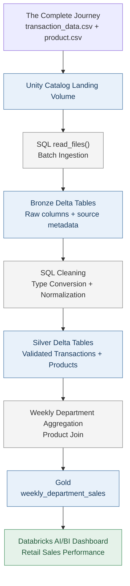
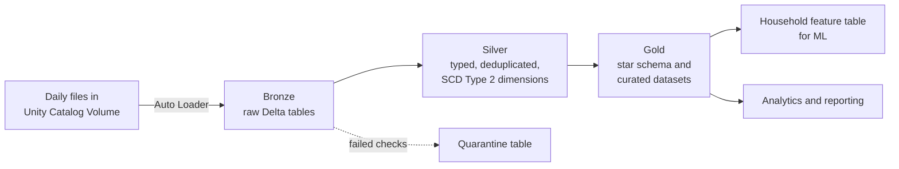
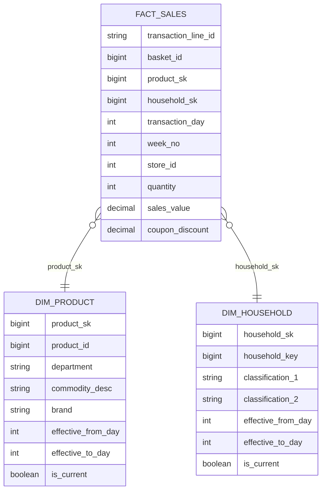
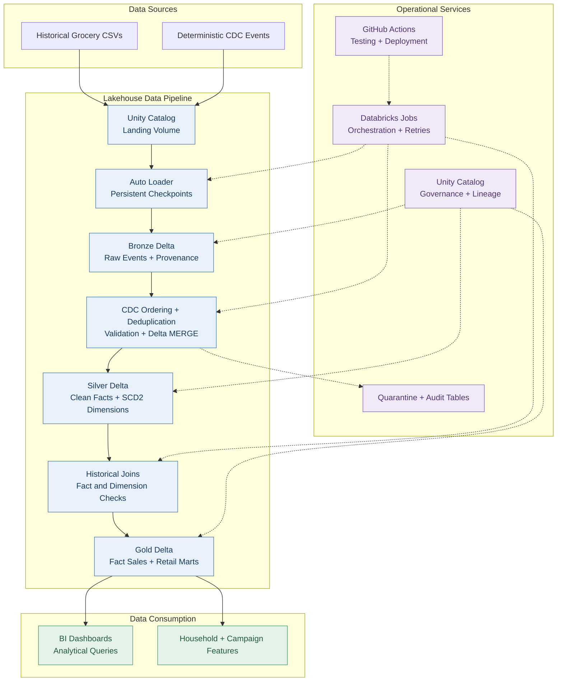

# Project Proposal — Grocery Retail & Loyalty Lakehouse

**Project:** Retail Analytics Lakehouse  
**Audience:** Data engineering, analytics, retail operations, merchandising  
**Status:** Living design specification. The batch MVP is implemented; later phases are proposals, not delivered features.

## 1. Summary and motivation

Develop a Databricks-based lakehouse that integrates historical grocery purchases with product and household reference data, then delivers trustworthy retail performance metrics.

### Why this project

Retail loyalty programs generate millions of transactions, and the teams that use that data need it to be current, accurate, and traceable over time. When a product classification or a household attribute changes, reports should preserve the correct historical version. The historical source files do not contain these change events: later phases will introduce **simulated** changes to test historical correctness. The target system adds incremental ingestion, dimensional modelling, quality gates, recovery, orchestration and curated outputs for analytics; the current MVP is a validated **batch SQL** pipeline.


The initial MVP already provides **batch Bronze–Silver–Gold processing** and a **Retail Sales Performance dashboard**. The next stages will introduce controlled incremental and CDC scenarios, automated jobs and CI/CD.

## 2. Business requirements

| ID | Stakeholder need | Analytical output | Success criterion |
|---|---|---|---|
| BR-01 | Identify revenue-driving departments | Ranked revenue bar chart and top-two share | Same-period totals reconcile to source |
| BR-02 | Understand time variation by department | Weekly revenue trend for leading categories | Labels respect relative `week_no` semantics |
| BR-03 | Investigate department participation | Department performance table (revenue, baskets, lines, revenue/basket) | Baskets calculated at the correct grain |
| BR-04 | Explain changes in products/households over time | Historical product and household dimensions | Past transactions retain correct historical attribution after changes |
| BR-05 | Evaluate loyalty and campaign engagement | Campaign/coupon marts, later phase | Known exposure ambiguities are documented |
| BR-06 | Trust the data used for decisions | Auditable data-quality checks and reconciliation | Critical failures block downstream publication |

Revenue is defined according to the dunnhumby dictionary: `sales_value` represents retailer receipts, which may differ from the shopper's net payment when manufacturer coupons are involved. The source guide does not establish a Canadian-dollar currency. The source uses relative transaction days and weeks rather than calendar dates.

## 3. Dataset selection and scope

**Selected source:** [dunnhumby — The Complete Journey (original CSVs)](https://www.dunnhumby.com/source-files/), a representation of approximately two years of transactions by about 2,500 households.

| Data file | Planned role | Implementation stage |
|---|---|---|
| `transaction_data.csv` | Sales receipt-line fact source | MVP: implemented |
| `product.csv` | Product master and classification dimension | MVP: implemented |
| `hh_demographic.csv` | Household attributes; partial household coverage | Phase 3 / 4 |
| `campaign_table.csv`, `campaign_desc.csv` | Campaign targeting and periods | Phase 4 |
| `coupon.csv`, `coupon_redempt.csv` | Coupon eligibility and redemptions | Phase 4 |
| `causal_data.csv` | Display and mailer indicators by store/product/week | Optional advanced phase |
| Synthetic CDC events | Product, household, and transaction changes | Phase 3; **not** present in source CSVs |

The original CSV release and the prepared `completejourney` R package are **not interchangeable**: counts and schemas differ. This project uses the original CSV release. Raw files remain outside GitHub; their usage and sharing terms should be checked before redistribution.

## 4. Current implemented architecture (MVP)



**Current delivery facts:** approximately 2.6 million receipt lines; Bronze-to-Silver and Silver-to-Gold transaction/revenue reconciliation passed; dashboard reports total retailer revenue, unique baskets, top-two revenue concentration, top departments, weekly trends, and department detail. All transformations are currently SQL batch refreshes. There is not yet an automated job dependency graph.

## 5. Proposed logical architecture (future state; not yet implemented)



| Layer | Tables | What happens |
|---|---|---|
| **Landing** | Unity Catalog Volume | Daily transaction files and CDC change files arrive here |
| **Bronze** | Existing: `bronze.transactions`, `bronze.products`. Planned: `bronze.product_changes`, `bronze.household_changes`, `bronze.transaction_changes` | Auto Loader will track new files with persistent checkpoints. Preserve provenance, ingestion time, change-event identifiers and rescued data when applicable. |
| **Silver** | Existing: `silver.transactions`, `silver.products`. Planned: historical dimensions, incremental transaction table and quarantine | Validate types and keys; deduplicate **events**, not legitimate receipt lines. Build SCD Type 2 and replay-safe corrections only after defining stable event and receipt-line keys. |
| **Gold** | Existing: `gold.weekly_department_sales`. Planned: `gold.fact_sales`, store/period marts, campaigns and household features | Preserve the current revenue mart; expand to a star schema with tested time-aware dimension joins and business-metric reconciliation. |

### Data model



**Modelling assumptions (future):** `transaction_line_id` must be designed and validated; it is **not** supplied by the source. SCD2 validity uses source-relative day numbers (or explicitly simulated event ordering), not invented calendar dates. Household classifications are anonymized; do not rename them to exact income or size attributes without evidence. The household dimension must accommodate households lacking demographic records (for example, with unknown attributes). Product/household changes are simulated, not historical change logs from dunnhumby.

## 6. Target operational architecture (future state)



### Bronze design

- Ingest daily files incrementally with Auto Loader and persistent checkpoints.
- Preserve raw attributes and source identifiers, including event timestamps and operation type when simulated CDC is introduced.
- Keep unexpected-schema data available for inspection; do not silently discard rescued rows.

### Silver design

- Standardize data types and natural keys, normalize product descriptions, validate domain rules and maintain quarantine for invalid records.
- Establish stable transaction-line identity before supporting corrections or deletes. `basket_id` alone identifies a purchase occasion, **not** a receipt line; `(basket_id, product_id)` must not be assumed unique without profiling.
- Apply deterministic event ordering and replay-safe Delta `MERGE` logic; define tie-breaking rules for duplicate/out-of-order changes.
- Implement SCD Type 2 for **simulated** product/household changes using explicitly defined effective periods (relative day or event sequence), closed-open non-overlapping intervals and a deterministic tie-breaker. Validate both expiration of the old row and creation of the new current row; label changes as simulated rather than observed historical updates.

### Gold design

- Existing: `weekly_department_sales`, grain `(week_no, department)`.
- Planned: `fact_sales`, `dim_product`, `dim_household`, store/time dimensions where data supports them, and campaign/loyalty marts.
- Separate overall unique baskets from department-level basket participation: a basket can contain multiple departments, so **do not sum departmental distinct basket counts** to calculate overall baskets.
- Make measures comparable: `quantity` may use unusual units in gas and miscellaneous transaction departments; document or segregate before presenting units-sold comparisons.

## 7. Quality and reliability requirements

**Currently measured and passed:** source/Bronze count checks, no rescued transaction rows, null business-key checks, Bronze product uniqueness, Silver count and decimal-revenue reconciliation, transaction/product referential integrity, and Gold count/revenue reconciliation. See [data_quality.md](data_quality.md) for results.

**Future quality gates:**

1. Validate file counts, schema conformance, required fields and product key uniqueness.
2. Quarantine row-level invalid records; escalate systemic failures rather than silently ignoring them.
3. Reconcile source → Bronze → Silver → Gold line counts and retailer revenue at a consistent precision.
4. Test CDC delete/correction semantics, historical SCD Type 2 joins, duplicate events and out-of-order arrival.
5. Reprocess an already completed batch and assert no unintended duplicates or divergent totals.
6. Capture job status, failures, watermark/checkpoint progress and recovery instructions.

## 8. Operations, development and deployment

- **Compute:** Databricks serverless SQL and/or serverless Jobs within Free Edition constraints.
- **Development:** Version-controlled SQL, Python for later generators/tests, `pyproject.toml` and a pinned pip environment snapshot.
- **Bundling:** `databricks.yml` development configuration; add job resources when orchestration is implemented.
- **Orchestration (future):** Databricks Jobs executes Bronze → validation → Silver → validation → Gold → validation with explicit dependencies and error handling.
- **CI/CD (future):** GitHub Actions for linting, tests and controlled bundle validation/deployment, with credentials stored in GitHub secrets or an approved federation flow.
- **Governance:** Unity Catalog schemas, Volume and source provenance are implemented; least-privilege role design and metadata governance are planned.

## 9. Delivery phases and acceptance criteria

| Phase | Scope | Status | Acceptance condition |
|---|---|---|---|
| 0 | Local development, CLI authentication, catalog + Volume | Done | CLI and Unity Catalog reachable |
| 1a | Source acquisition and initial inspection | Done for transactions/products | Files ingested and initial quality checks documented |
| 1b | Daily source-file generator | Not started | Deterministic repeatable batches |
| 2 | Batch medallion pipeline and sales dashboard | Done, publication pending | All count/revenue checks pass; dashboard shows KPIs and charts |
| 3 | Incremental ingestion, CDC and SCD2 | Planned | Replay safety and historical validity demonstrated |
| 4 | Loyalty features, automatic jobs, CI/CD | Planned | Scheduled/repeatable job with quality gates and tested deployment |
| 5 | Benchmarking and portfolio polish | Planned | Measured results with limitations and reproducible artifacts |

## 10. Open questions and risks

- **Receipt-line identity:** The source has no established stable receipt-line ID. The correction/delete design cannot safely merge on `basket_id` or `(basket_id, product_id)` without demonstrating uniqueness; source-row identity and event IDs must be defined and verified.
- **Quantity semantics:** Gas and miscellaneous transaction quantities are unusually large relative to revenue; comparing units across departments may mislead.
- **Unmapped grouping:** Gold currently includes an `UNMAPPED` category with zero aggregate revenue and units. Product-key referential integrity passed, so investigate missing/blank product department fields and the associated transaction rows; don't assume a failed join.
- **Historical dates:** `day` and `week_no` are relative; don't report fabricated calendar dates.
- **Campaign exposure:** TypeA coupons are selected from a pool and precise household-level offer exposure may not be identifiable; avoid unjustified causal claims.
- **Source and license:** Data is a representation of retail behavior, not a live production feed. Verify redistribution terms and do not commit the original source CSVs. The guide uses dollar values but does not establish CAD.
- **Free Edition:** Quotas and resource limits could constrain benchmark sizes, Job schedules, or concurrency.

## 11. Project artifacts

- [README](../README.md): current delivered capabilities and setup.
- [Data-quality report](data_quality.md): executed checks and pending quality work.
- `sql/`: version-controlled transformations and validations.
- Databricks AI/BI dashboard: business-facing analytics; save a screenshot under `docs/images/`, and optionally export a `.lvdash.json` definition. Published dashboards are not necessarily accessible to unauthenticated recruiters.

**Design principle:** Every published claim should correspond to an implemented artifact or observed result. Planned features remain explicitly marked as planned until tested.

## 12. Key implementation techniques — design for later phases

These techniques are **planned**, not claims about the current MVP.

### Incremental ingestion

- Introduce a deterministic daily-feed generator that splits the historical transactions into reproducible batches. The generator is not yet implemented.
- Use Auto Loader and persistent checkpoints to track source files and recover ingestion progress. Under its normal file-processing contract and intact checkpoint state, Auto Loader tracks files already ingested; changing checkpoint state, file paths or overwrite settings changes replay behavior.
- Keep file-level ingestion guarantees separate from **business-level CDC idempotency**, which must be verified independently. See [Databricks Auto Loader documentation](https://docs.databricks.com/aws/en/ingestion/cloud-object-storage/auto-loader).

### CDC and slowly changing dimensions (SCD Type 2)

- Define source operation (`INSERT`/`UPDATE`/`DELETE`), event identifier, effective period, deterministic sequence and tie-breaking semantics for **simulated** change events.
- For an SCD2 update, expire the existing current dimension version **and** insert a new current version, using a tested staged-MERGE pattern or supported managed CDC pipeline. For deletes, define whether the business requires a closed version, tombstone or deletion flag.
- Test one current dimension row per natural key, non-overlapping effective periods, duplicate/out-of-order events and correct historical fact attribution.
- Use source-relative transaction days or explicitly simulated event periods; do not manufacture real calendar dates.

### Transaction identity and idempotent fact loading

- First profile the **receipt-line grain**. A basket can contain many products, and `(basket_id, product_id)` has **not** been proved to be a unique line key.
- Define a stable `transaction_line_id` and `event_id` in the deterministic input contract before using `MERGE` for corrections and deletes. A synthetic line ID must remain stable under a replay of the *same* source record.
- Replay a completed batch and assert that row counts, aggregate revenue and relevant table state do not change unexpectedly. Include a correction, a delete and an out-of-order update in tests.

### Data quality and quarantine

- Current stage: version-controlled, **manually run** SQL validation; Gold revenue and line counts reconcile with Silver.
- Proposed stage: automated quality-gate tasks for required keys, source/target totals, conversion errors, product foreign keys and replay correctness.
- Quarantine recoverable row-level exceptions with error reasons; **fail or alert** on critical systemic issues (such as widespread schema changes or large reconciliation discrepancies). Do not promise that all errors can safely be ignored.

### Orchestration and recovery

- Define a Databricks Job in a bundle resource file such as `resources/loyalty_job.yml` **when implemented**, with ordered tasks:

  ```mermaid

    flowchart TB
        A["Start Databricks Job"]
        B["Ingest Bronze"]
        C["Validate Bronze"]
        D{"Quality Checks Pass?"}
        E["Build Silver"]
        F["Validate Silver"]
        G{"Quality Checks Pass?"}
        H["Build Gold"]
        I["Validate Gold"]
        J{"Reconciliation Passes?"}
        K["Pipeline Successful"]
        L["Fail Job + Capture Error"]
        M["Investigate + Recover<br/>Retry or Backfill"]

        A --> B
        B --> C
        C --> D

        D -->|Yes| E
        D -->|No| L

        E --> F
        F --> G

        G -->|Yes| H
        G -->|No| L

        H --> I
        I --> J

        J -->|Yes| K
        J -->|No| L

        L --> M

        classDef task fill:#E8F1FA,stroke:#4A79A8,color:#17395C
        classDef decision fill:#FFF0D9,stroke:#C38A38,color:#714A15
        classDef success fill:#E5F2E9,stroke:#4B9666,color:#215A39
        classDef failure fill:#FCE9E9,stroke:#C45D5D,color:#812E2E

        class B,C,E,F,H,I task
        class D,G,J decision
        class K success
        class L,M failure

  ```

- Add retriable tasks, monitoring and a `docs/runbook.md` documenting recovery/backfills **after those artifacts exist**. The current `databricks.yml` provides a development target but no job-resource dependency graph.

### Governance

- **Implemented:** separate `retail_analytics` catalog, landing Volume and medallion schemas, with basic source-lineage columns in Bronze/Silver.
- **Planned:** table/column comments, documented least-privilege analyst grants, lineage review, and appropriate access controls for dashboard sharing.

## 13. Testing and CI/CD — planned

- Introduce testable Python modules only where they add value (for example, daily-feed generation and event simulation); the current transformations are SQL scripts.
- Add unit tests for event sequencing, stable line IDs and SCD2 validity, together with integration tests that exercise Delta tables in Databricks.
- Configure GitHub Actions for linting, tests and bundle validation; add controlled deployment when a job resource and secure authentication exist.
- Treat a green test/CI status as evidence only **after** the workflow has been committed and executed.

## 14. Technology inventory

**Used in MVP:** Databricks SQL, Delta Lake, Unity Catalog, Databricks AI/BI Dashboards, SQL, Databricks CLI and a minimal bundle development configuration.

**Planned:** PySpark, Auto Loader, Structured Streaming/checkpoints, Delta CDC/MERGE, SCD Type 2, Databricks Jobs, automated data-quality gates, Python/pytest integration tests and GitHub Actions CI/CD.

## Author

**Sopuruchi Chisom** | [LinkedIn](https://linkedin.com/in/sopuruchi-chisom) | [GitHub](https://github.com/cs-uche)
